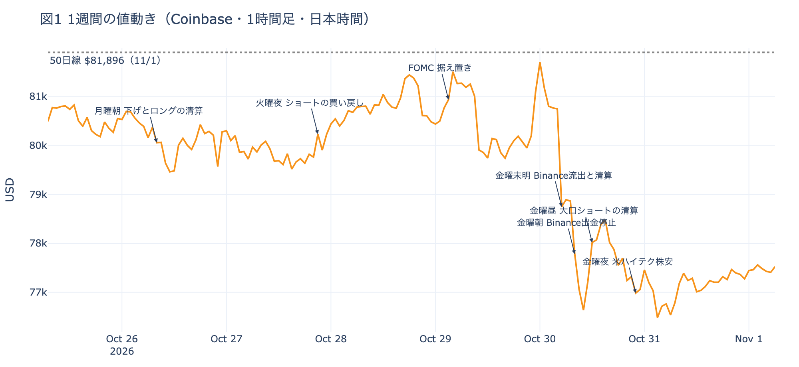
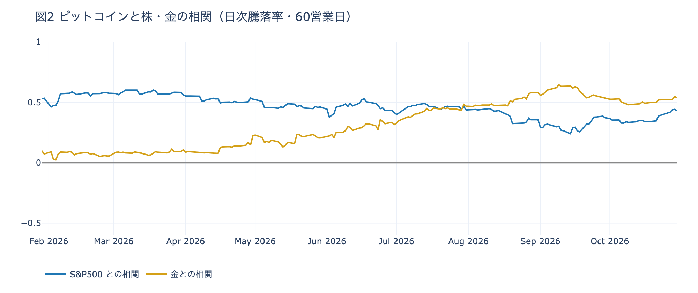

# 【10/26〜11/01】平日の$80,000を保ったのは先物の往復で、現物の買い手はETFまでそろって引いた

**2026年11月1日**

ビットコインはこの1週間で3.5%下げました。月曜から木曜の日中までは$80,000のまわりにとどまりましたが、Binance の不審な資金の流出と米国のハイテク株安が重なった金曜の前後に、週の安値の$76,141まで下げています。平日の値を保ったのは新しい買い手ではなく、先物の賭けの出し入れでした。現物を持つ側は、長期保有者・米国の取引所の買い手・ETFの3つがそろって売りの側で週を終えています。この号の「1週間」は、日本時間の10月25日朝7時から11月1日朝7時までです。毎朝出している日次の号のうち、10/26〜11/01 の7本が扱った期間にあたります。

* **起きたこと**：長期保有者（＝155日以上保有者）の売りは前の週の1.6倍に広がり、米国の取引所はさらに安くなった。ETFは金曜の1日で、その前の4日分の買いを打ち消した
* **この週は**：先物で下げに賭けた人が、積んでは数時間で買い戻す往復が、平日の$80,000を保ったと見ている。往復は差し引きで買いを残さないので、現物の売りを受け止めてはいない
* **この売りの性質**：現物を持つ3つの買い手がそろって引いた。先物で上げに賭ける人は降りきらず土曜に積み直したが、すぐ降りる抜けやすい支えで、3つの買い手の代わりにはならない
* **確かめる数字**：Coinbase Premium、ETF、資金調達率と短期金利の差、建玉の4つで、この形が続いているかを確かめられる

## 1. 現物の売りは前の週より強まり、週の終わりの2日で$76,000台へ下げた

**図1 1週間の値動き（Coinbase・1時間足・日本時間）**

この週、現物を売る側はさらに強くなりました。長期保有者が持つ量は、30日間で約17.6万BTC減っています（1週間の平均）。前の週の約11.1万BTCから、減り方は1.6倍に広がりました。7つの号はどれも、減り方が前の週より広がったと書いています。動いたコインは平均して買値より高く動いていて、利益確定の売りです。

買う側は、米国で弱まりました。米国の取引所 Coinbase の価格は海外の取引所より安い状態が続き、この価格差を表す Coinbase Premium（＝アメリカとそれ以外の価格差）は、1週間平均で前の週より沈んでいます。マイナスは米国の買いが弱いことを表します。ETF（＝証券口座から買えるビットコインの投資信託）は月曜から木曜まで4日続けて小さく入り超でしたが、金曜の1日で8月以降最大の流出となり、週の合計は出超に変わりました。

値動きは2つに分かれます。月曜から木曜の日中までは、$80,000を挟んで上下しながら、その少し下から$81,000台の間にとどまりました。崩れたのは週の終わりです。金曜1時台に週の高値の$81,890をつけたあと、金曜の未明・朝・夜の3回の下げを経て、土曜3時台に週の安値まで下げています。日ごとの動きは末尾の表にまとめました。

## 2. 平日の$80,000は、先物の賭けの往復で保たれていた

平日に売りを受け止めたように見えたのは、先物の参加者でした。仕組みは4段でつながっています。

**① 下げの場面でショートが積まれ、数時間で買い戻される。** ビットコインそのものは受け渡さず、値上がりか値下がりかだけに賭ける取引があります。これが先物で、手元のお金の一部を担保（＝証拠金）として預ければ、その何倍もの額で賭けられます。上げに賭ける側を買い持ち（ロング）、下げに賭ける側を売り持ち（ショート）と呼びます。月曜から木曜の日中まで、4つの号が同じ形を書きました。価格が下げる場面で建玉（＝先物の未決済残高。証拠金で張っている人の量）が増えてショートが積まれ、数時間後には価格が戻りながら建玉が減って、そのショートが買い戻されます。火曜の夜からの戻りと、FOMC（＝米国の金利を決める会合）の据え置きのあとの木曜未明の戻りは、ショートの清算（＝証拠金不足で強制的に閉じられた取引）が加速させました。

**② 往復は、差し引きで買いを残さない。** ショートの買い戻しは、自分が売った分を自分で買い戻しているだけです。下げのたびに価格は戻りますが、長期保有者が売ったコインを引き取る買いは、この往復からは生まれません。FOMCの夜も、結果を待って積まれたショートが未明に買い戻されただけでした。平日の$80,000は、下げに賭けた人が深追いしなかった水準であって、新しい買い手が支えた水準ではなかったと見ています。

**③ 平日に現物を引き取ったのは、値段の差を埋める業者だったと見ている。** ロングは7つの朝すべてで、資金調達率（＝ロングが払う金利。プラス＝ロングがショートより多い）として、短期金利（＝ドルを米国の短期国債で持つだけで受け取れる金利）を上回る分を払っていました。1本目の号の週（10/12〜10/18）は、7つの朝のうち4つでこの差がマイナスでした。差がプラスなら、現物を買い、同じ量の先物でショートを持つ裁定業者に、現物を持ち続ける理由ができます。ETFの小さな入り超とあわせて、平日に長期保有者の売りを引き取ったのはこの業者だったと見ています。誰が現物を買ったかを示すデータは無く、ここは先物と現物をつなぐふつうの仕組みからの見立てです。

**④ 週の終わりの2つの出来事で、往復が片道になった。** 金曜未明1時台からロングの手仕舞いが始まり、5時台、米国の引け後の取引でハイテク株が売られ、Binance から不審な資金が流出した時間に、清算がそれを加速させました。Binance が約63億ドル規模のハッキングを認めて出金を止めたと伝わった金曜の朝には、下げの中で新しいショートが積まれます。昼に一度買い戻されたものの、夜はナスダックが3%近く下げた米国の取引時間に積み直され、買い戻しきられないまま週末に入りました。盗まれた約1.8万BTCは送られておらず、売られたことによる下げではありません。

①の建玉の往復と、③の金利の差は、数字で確かめたことです。

## 3. 先物の賭けは残ったが、現物を持つ3つの買い手はそろって引いた

裁定業者が持つ現物は、ロングが金利を払ってくれるあいだだけ持つ、借り物の買いです。そのロングは金曜の下げでも降りきりませんでした。土曜には小さな戻りの中でロングが積み直され、短期金利に対してロングが余分に払う分は、この1か月でいちばん大きくなっています。先物で上げに賭ける人は、金曜の下げを一時的な押しと見ています。

現物を持つ側は、逆を向いています。長期保有者は$70,000台後半でも売りを細らせず、米国の取引所の買い手は、木曜と金曜に今年いちばん深く引きました。前の週に入り超だったETFは、金曜に主なファンドがそろって流出しています。前の週と比べると、3つとも売りの側へ寄りました。土曜にロングが積み直された日も、米国の取引所の買い手は戻っていません。

8月と9月には、ETFに合わせて約62億ドルが入っていました。10月は約5.2億ドルの出超で終わっています。値段の支えは、現物を持ち続ける買い手から、金利を受け取れるあいだだけ持つ業者と、すぐ降りる先物の賭けへ寄ったままで、前の週までより細くなったと見ています。

### 一歩引くと：株との相関は高まったが、株が崩れた日にビットコインは株ほど下げなかった

**図2 ビットコインと株・金の相関（日次騰落率・60営業日）**

ふだんのビットコインは、株とも金とも、ある程度は連れて動くものの、どちらの仲間とも決まっていません。相関（＝2つの値動きがどれだけ同じ向きにそろうか。1に近いほどそろう）は、直近30営業日では米国の代表的な株価指数 S&P500 との値が高い一方、90営業日では金のほうが高くなります（数字は末尾の表）。

この1週間（米国の5営業日）は、ビットコインが−4.8%、S&P500が−0.6%で、株よりはるかに大きく下げています。ただ、株が崩れた日に限ると形が違います。直近1年に、VIX（＝株式市場の恐怖指数）が1日で10%以上跳ねた日は28回あり、その日の値動きの中央値は、ビットコインが−2.26%、S&P500が−1.28%でした。この週の金曜はそのうちの1回ですが、ビットコインは−0.77%と、S&P500の−1.82%より小さく済んでいます。

ビットコインが大きく下げたのは、その前日（米国の日付で木曜）です。米国の7〜9月期GDPと9月のPCE物価が出た時間にはむしろ上げていて、下げたのは米国の引け後のハイテク株安と Binance の流出が重なった未明と、出金停止が伝わった朝でした。FOMCが据え置いた水曜も、株とビットコインは小さく上げただけです。経済指標にも、株が怖がられた日にも、ビットコインは株より大きくは反応していません。この週に株より大きく下げた分は、業界の事故と引け後の売りを、先物の持ち高が押し広げた分だったと見ています。株と同じリスク資産として値付けされた週とは言えません。

## 4. この形が続いているかは、4つの数字で確かめられる

| 数字 | いまの値 | 何がわかるか |
|---|---|---|
| Coinbase Premium（1週間平均） | −0.183%（前の週 −0.123%） | プラスに戻れば、現物を持ちたい米国の買い手が帰ってきたしるし |
| ETF（週の5営業日の合計） | −2.0億ドル（金曜は −6.4億ドル） | 入り超に戻れば、8〜9月の戻りを支えた買い手が帰ってきたしるし |
| 資金調達率と短期金利の差 | +6.98pt | プラスで大きいほど、裁定業者が現物を持つ理由がある。この週は7つの朝すべてでプラスだった |
| 建玉（1週間の変化） | +3.3% | 上げの中で増えればロング、下げの中で増えればショートが積まれている |

週明けから、この4つを揺らしうる予定が並んでいます。オプションは、決めた期日に、決めた価格でビットコインを売り買いできる権利です。その期日を満期と呼び、売る権利をプット、買う権利をコールと呼びます。いまはすべての満期でプットの権利料のほうが高く、その差がいちばん大きいのは、米国の中間選挙の結果が出たあとの最初の満期の11月4日です。IV（＝値動きの幅の予想）もこの満期がいちばん高く、参加者は選挙の結果で大きく動くなら、上げより下げに身構えています。一方、年末の12月25日の満期では、いまの価格より上のコールが下のプットの1.5倍あり、上げへの賭けも手放されていません。

| 日付 | イベント | 何に効くか |
|---|---|---|
| 11/1（日） | Binance の出金の再開（Binance は日曜までの再開を目指す） | ビットコイン |
| 11/1（日） | OPEC+の7か国の会合。12月の生産量を決める | 原油 |
| 11/3（火） | 米国の中間選挙。結果は日本時間4日以降 | 株・金利 |
| 11/4（水）17:00 | オプションの満期。IVとプットの高さが全満期でいちばん大きい | 下げへの備えの期限 |
| 11/6（金）22:30 | 米国の10月の雇用統計（日本時間） | 金利 |
| 12/9（水） | FOMC。市場が見込む利上げの確率は約8割 | 金利。結果は日本時間10日早朝 |
| 12/25（金）17:00 | オプションの最も大きな満期（全満期の45%） | 約$90,000以上のコールの期限 |

## 数字の置き場

### 7つの号が書いたこと

| 号 | 朝7時5分の価格 | 前の朝からの動き |
|---|---|---|
| 10/26（月） | 約$80,615 | 日曜は横ばい。土曜の夜に積まれたショートが手仕舞われ、ロングは残った。きっかけは無い |
| 10/27（火） | 約$79,913 | 株高の月曜に$80,000をわずかに割る。朝と夜の下げでショートが積まれ、数時間で買い戻された |
| 10/28（水） | 約$80,875 | 昼に積まれたショートが夜に買い戻され、清算が上げを加速。米国の取引所は今年いちばん安い |
| 10/29（木） | 約$81,173 | FOMCは据え置き。夜に積まれたショートが、結果のあとの未明に買い戻された |
| 10/30（金） | 約$78,671 | 日中は同じ往復。未明5時台、引け後のハイテク株安と Binance の流出の時間に、ロングの清算が下げを加速 |
| 10/31（土） | 約$76,700 | Binance がハッキングで出金を停止。下げの中でショートが積まれ、夜は米国のハイテク株安 |
| 11/01（日） | 約$77,600 | 土曜は$77,000台で足踏み。小さな戻りの中でロングが積み直された |

1週間の値幅は7.6%で、高値は30日1時台の$81,890、安値は31日3時台の$76,141です。

### 参加者ごとの数字

| 参加者 | この週の動き | 根拠 |
|---|---|---|
| 長期保有者 | 利益確定の売りが広がった | 保有量の30日変化（1週間平均）が約−11.1万BTC → 約−17.6万BTC |
| 米国の現物の買い手 | 取引所でさらに引き、ETFも金曜に売りへ回った | Coinbase Premium の1週間平均が −0.123% → −0.183%。ETFは5営業日で流入4日・流出1日、差し引き −2.0億ドル（前の週は +3.0億ドル） |
| 先物の参加者 | 下げでショートを積んでは買い戻し、ロングは降りきらなかった | 建玉は1週間で +3.3%。資金調達率と短期金利の差は7つの朝すべてでプラス（+2.57〜+6.98pt）、週の終わりは +6.98pt |
| オプションの参加者 | FOMCの前後だけ目先の下げへの備えを外し、金曜の下げのあとに戻した | 7つの号のうち5つで、すべての満期でプットの権利料がコールより高かった（10/28・10/29の号だけ、10月末までの満期でコールが高いかほぼ差なし）。10月30日の大きな満期は$90,000に届かずに期限を迎えた |
| 市場心理 | 「中立」から「恐怖」へ | Fear & Greed（＝市場心理の指数）が 51 → 30（10/30 に1日で21pt下げた） |

- ETFの数字は米国の10/26〜10/30 の5営業日です

### 株・金との相関

| 相関を測った期間 | S&P500 | 金 |
|---|---:|---:|
| 30営業日（9/21〜） | +0.64 | +0.24 |
| 90営業日（6/25〜） | +0.37 | +0.51 |
| 180営業日（2/13〜） | +0.43 | +0.36 |
| 1年（2025/11/03〜） | +0.47 | +0.24 |

---

<small>（数値は11月1日7時7分（日本時間）までのデータに基づきます。価格は Coinbase の1時間足で、1週間は10月25日7時から11月1日7時までです。相関と騰落率は、ビットコインの日足（UTC 0時締め）と、株・金・VIX が米国で取引された日の終値を、同じ米国の日付どうしで合わせて計算しました。長期保有者の保有量は10月30日時点で、ETFや取引所が預かっている分も含みます。ETF資金フローは10月30日分までです。FOMCの見込みは10月30日のFF金利先物の終値から計算したものです。オプションは Deribit の全銘柄です。）</small>

*本稿は情報提供を目的としたものであり、投資助言ではありません。将来の価格動向を保証・示唆するものではなく、投資判断は各自の責任において行ってください。*
