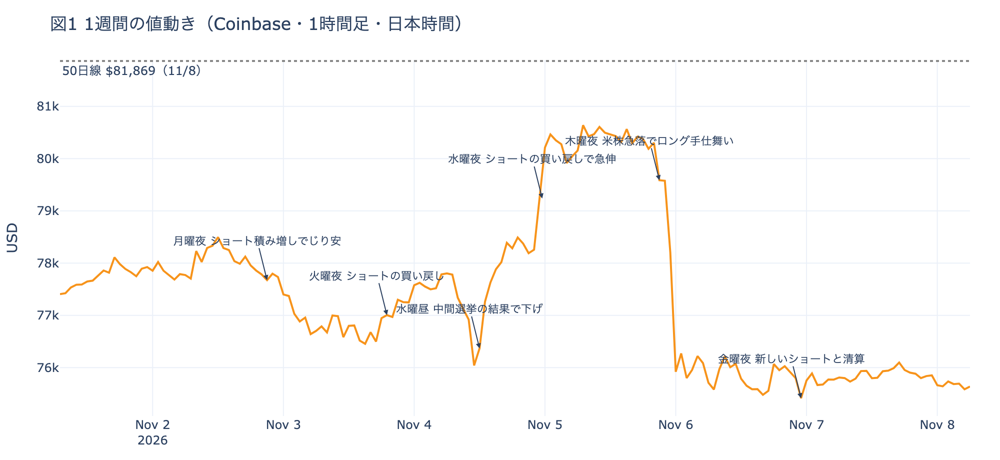
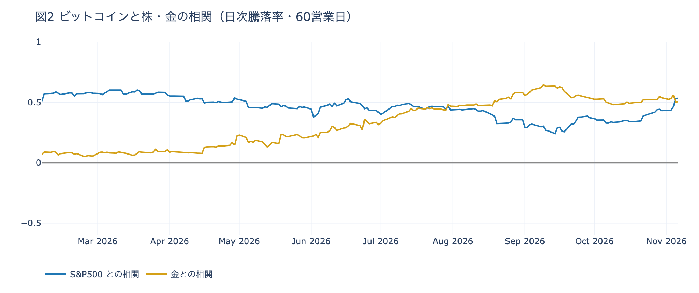

# 【11/02〜11/08】選挙と株安の上下は先物の出し入れで消え、長期保有者は買値を割っても保有量を減らした

**2026年11月8日**

ビットコインはこの1週間で2.4%下げました。大きく動いたのは、中間選挙の結果が出た水曜の夜の上げと、米国株が急落した木曜の夜の下げの2晩です。どちらも先物の賭けが閉じる動きで運ばれ、上げは1日で消えました。その下で現物を持つ側は売りを続け、長期保有者は週の終わりに、買値を下回る価格でも保有量を減らす形に変わっています。この号の「1週間」は、日本時間の11月1日朝7時から8日朝7時までです。毎朝出している日次の号のうち、11/02〜11/08 の7本が扱った期間にあたります。

* **起きたこと**：選挙の結果が出た夜に$80,000台へ上げ、米国株が4%下げた夜に$75,000台へ戻った。ETFは5営業日のうち4日が流出で、合計は約12.8億ドルの出超
* **この週は**：上げはショートが降りただけ、下げはロングが降りただけで、新しい買いは積まれなかったと見ている。先物の出し入れは差し引きで何も残さず、値段は現物の売りの側に戻った
* **この売りの性質**：長期保有者が動かしたコインは、週の終わりに平均して買値を下回った。前の週までの利益確定の売りとは違い、高値で受け取ったコインが値下がりしたまま送金され始めた
* **確かめる数字**：資金調達率と短期金利の差、長期保有者が動かしたコインの売値と買値の比、ETF、Coinbase Premium の4つで、この形が続いているかを確かめられる

## 1. 2つの晩に上下8%動き、週の終わりは$75,000台で止まった

**図1 1週間の値動き（Coinbase・1時間足・日本時間）**

この週、値段を大きく動かしたのは2つの晩でした。水曜は、米国の中間選挙で民主党が上下両院を制した結果が出た昼に$75,000台まで下げ、夜、米国株の取引が始まると$80,000台へ上げています。翌日の木曜の夜は、AI関連と半導体を中心に米国の代表的な株価指数 S&P500 が4.4%下げた時間に$75,000台へ戻り、前の晩の上げをすべて失いました。

ほかの日は小さく動いただけです。週の初めは選挙を前に$76,000〜$78,000台で下げては戻し、金曜は米10月雇用統計が予想を大きく上回っても、値段はほとんど動きませんでした。週の安値は、その金曜の夜の$74,722です。土曜は、この週でいちばん静かな24時間でした。

現物を売る側は、週を通して強いままでした。ETF（＝証券口座から買えるビットコインの投資信託）は流出が続き、米国の取引所 Coinbase の価格は海外の取引所より安いままでした。この価格差を Coinbase Premium（＝アメリカとそれ以外の価格差）と呼び、マイナスは米国の買いが弱いことを表します。7つの朝すべてで、1週間平均はマイナスです。長期保有者（＝155日以上コインを動かしていない持ち主）の保有量は、30日間で約22.5万BTC減っています（1週間の平均）。日ごとの動きは末尾の表にまとめました。

## 2. 上げも下げも、先物の賭けが閉じる動きだった

2つの晩を運んだのは、先物の参加者でした。仕組みは4段でつながっています。

**① きっかけは外部環境で、動く時刻は米国株の取引開始が決めた。** 水曜の夜の上げは、米国株が上げ、原油が急落した時間に起きました。木曜の夜の下げは、米国株が急落した時間です。どちらの晩も、速く動いたのは米国株の取引が始まる日本時間23時30分の前後でした。ビットコインに固有の出来事で、この2晩の値動きに合うものは見当たりません。

**② 上げはショートが降り、下げはロングが降りた。** ビットコインそのものは受け渡さず、値上がりか値下がりかだけに賭ける取引が先物です。手元のお金の一部を担保（＝証拠金）として預ければ、その何倍もの額で賭けられます。上げに賭ける側を買い持ち（ロング）、下げに賭ける側を売り持ち（ショート）と呼びます。水曜の夜は、値段が上がりながら建玉（＝先物の未決済残高。証拠金で張っている人の量）が減りました。月曜の夜から積まれていたショートが、買い戻して降りた形です。木曜の夜は値段と建玉がほぼ同じ割合で減っていて、上げに賭けていたロングが降りています。どちらの晩も、清算（＝証拠金不足で強制的に閉じられた取引）が動きを加速させました。

**③ 新しい買いが入っていない上げは、一晩で消える。** 賭けを閉じる売り買いは、自分が持っていた分を手放しているだけです。水曜の上げの大きさのわりに、新しいロングは積まれていません。株が崩れた木曜の夜、上げを支えるものは何も残っていなかったということです。ほかにも、月曜と金曜の夜には下げの中で新しいショートが積まれ、火曜の夜にはその一部が買い戻されています。こうした出し入れを差し引くと、建玉は1週間でほとんど変わっていません。先物は値段を上下に運びましたが、週の終わりには何も残していません。

**④ 週の終わりに、ロングが余分に払う分が消えた。** ロングが多いと、ロングはショートに金利を払います。これが資金調達率（＝ロングが払う金利。プラス＝ロングがショートより多い）で、比べる相手は短期金利（＝ドルを米国の短期国債で持つだけで受け取れる金利）です。資金調達率は7つの朝すべてで短期金利を上回りましたが、その差は週の初めの+6.98ptから、日曜の朝には+0.61ptまで縮みました。この差は、現物を買って同じ量の先物でショートを持つ裁定業者にとって、現物を持ち続ける理由になります。前の週に平日の売りを引き取ったと見ていたこの業者にとって、うまみは週の終わりに薄れました。業者が現物を売ったかを示すデータは無く、ここは見立てです。

②の建玉の向きと、④の金利の差は、数字で確かめたことです。

## 3. 現物の売りは、利益確定から値下がりしたままの送金へ変わり始めた

先物が上下に往復しているあいだ、現物を持つ側は買いに回りませんでした。

長期保有者は、週の終わりに形を変えています。保有量は30日間で減り続け、減り方は前の週の約17.6万BTCから広がりました。そして11月6日時点では、長期保有者が動かしたコインは、平均して買値より安く動くようになっています。前の週までは利益の側で手放していたので「利益確定の売り」と呼べましたが、いまは高値で受け取ったコインが、値下がりしたまま動いています。7つの号のうち6つは「利益確定の売り」と書きました。損益の数字が10月末までの時点のままだったためで、変わったことが見えたのは日曜の号だけです。

送金の記録も同じ向きです。30日以上置いたコインが、最後に送金された日より安い価格で再び送金された量は、1週間平均で1日約1.4万BTCから約2.4万BTCに増え、2017年以降で上から13%に入りました。ただ、過去の大きな下げの底では1日4万〜8万BTCを超えていて、そこまでまとまった動きにはなっていません。

買い手も戻っていません。ETFの流出は、この週の5営業日だけで10月1か月分の2倍を超えました。入り超は、選挙の結果を受けて値段が上げた米国の11月4日の1日だけで、額も小さいものでした。米国の取引所の買い手は、上げの夜も沈んだままで、下げの夜にはさらに沈んでいます。

反例もあります。Coinbase Premium の1週間平均は前の週より少し浅く、米国の取引所の買い手が売りをさらに強めたわけではありません。それでも、1本目の号の週は先物のロングの積み直しが、前の週はショートの往復が値段を保ち、この週は往復の幅が広がって何も残しませんでした。現物を持ち続ける買い手が値段を受け止める形は4週続けて戻っておらず、土台は前の週より弱くなったと見ています。

### 一歩引くと：大きく動いた2晩は、どちらも株と同じ向きだった

**図2 ビットコインと株・金の相関（日次騰落率・60営業日）**

ふだんのビットコインは、株とも金とも、ある程度は連れて動くものの、どちらの仲間とも決まっていません。相関（＝2つの値動きがどれだけ同じ向きにそろうか。1に近いほどそろう）は、測る期間によって株が上になったり金と並んだりします（数字は末尾の表）。ただ、直近30営業日の S&P500 との相関は+0.74で、1本目の号の+0.59、前の週の+0.64から高まりました。

この週は、測り方を変えても株の側に寄っています。選挙の結果が出た水曜は株もビットコインも上げました。木曜は VIX（＝株式市場の恐怖指数）が1日で約70%跳ね、ビットコインは−5.54%、S&P500 は−4.36%で、金は上げています。株が崩れた晩、ビットコインは金ではなく株と同じ側で売られたということです。

ただ、株より大きく下げる型からは外れています。直近1年に VIX が1日で10%以上跳ねた日は28回あり、その日の値動きの中央値はビットコインが−2.26%、S&P500 が−1.34%と、株の1.7倍でした。この週の木曜は1.3倍です。週全体（米国の5営業日）でもビットコインは−1.9%と、S&P500 の−2.7%より小さく、米10月雇用統計の金曜は株と逆向きに小さく動いただけでした。この週のビットコインは株と同じリスク資産として値付けされ、株が動いた晩に、先物の賭けが閉じて値段を運んだと見ています。

## 4. この形が続いているかは、4つの数字で確かめられる

| 数字 | いまの値 | 何がわかるか |
|---|---|---|
| 資金調達率と短期金利の差 | +0.61pt（週の初めは +6.98pt） | プラスで大きいほど、裁定業者が現物を持つ理由がある。この週は7つの朝すべてでプラスだったが、日曜の朝にほぼ消えた |
| 長期保有者が動かしたコインの売値÷買値（1週間平均） | 0.98（前の週 1.08） | 1を上回って保有量が減れば利益確定の売り。1を下回ったまま減り続ければ、値下がりしたままの送金が続いている |
| ETF（週の5営業日の合計） | −12.8億ドル（前の週 −2.0億ドル） | 入り超に戻れば、9月の戻りを支えた買い手が帰ってきたしるし |
| Coinbase Premium（1週間平均） | −0.150%（前の週 −0.182%） | プラスに戻れば、現物を持ちたい米国の買い手が帰ってきたしるし |

週明けから、この4つを揺らしうる予定が並んでいます。オプションは、決めた期日に、決めた価格でビットコインを売り買いできる権利です。その期日を満期と呼び、売る権利をプット、買う権利をコール、買う人が払う金額を権利料と呼びます。いまはすべての満期でプットの権利料のほうが高く、その差がいちばん大きいのは、米10月CPI（＝米国の物価統計）やエヌビディアの決算、FOMC（＝米国の金利を決める会合）の議事要旨のあとに来る11月20日の満期です。一方、年末の12月25日の満期では、いまの価格より上のコールの持ち高が、下のプットの1.5倍あります。参加者は目の前の下げに備えながら、年末に向けた上げへの賭けは降ろしていません。

| 日付 | イベント | 何に効くか |
|---|---|---|
| 11/10（火）22:30 | 米10月CPI（日本時間） | 金利 |
| 11/13（金）22:30 | 米10月の生産者物価指数（日本時間） | 金利 |
| 11/18（水）朝 | エヌビディアの8〜10月期決算（米国17日の引け後。日本時間） | 米国株。この週の株安はAI関連と半導体が中心だった |
| 11/19（木）4:00 | FOMC の議事要旨（10月27〜28日分。日本時間） | 金利 |
| 11/20（金）17:00 | オプションの満期。プットの権利料の高さが全満期でいちばん大きい | 下げへの備えの期限 |
| 日程は未定 | 米国とイランの協議。合意には至っていない | 原油 |
| 日程は未定 | 米労働省の、401(k)（＝米国の確定拠出年金）で暗号資産などを扱いやすくする規則。11月5日にホワイトハウスの最終審査に入った | 米国の買い手 |
| 12/9（水） | FOMC。市場が見込む利上げの確率は約8割（1週間前も約8割） | 金利。結果は日本時間10日早朝 |
| 12/25（金）17:00 | オプションの最も大きな満期（全満期の41%） | 約$88,000以上のコールの期限 |

## 数字の置き場

### 7つの号が書いたこと

| 号 | 朝7時5分の価格 | 前の朝からの動き |
|---|---|---|
| 11/02（月） | 約$77,755 | 日曜は$77,000台で小さく上下。Binance の出金再開でも上げは0.5%ほど。昼に積まれたロングが未明に手仕舞われた |
| 11/03（火） | 約$76,679 | 中間選挙の前夜、夕方から未明に新しいショートが積まれてじり安。きっかけは無い |
| 11/04（水） | 約$77,733 | 投票日の夜、ショートの買い戻しで戻す。建玉は前日の朝とほぼ同じ |
| 11/05（木） | 約$80,210 | 民主党が両院を制した昼に$75,000台へ下げ、夜は米国株の取引開始からショートの買い戻しと清算で$80,000台へ |
| 11/06（金） | 約$75,854 | 米国株が4.4%下げた夜、ロングの手仕舞いを清算が加速させ、前夜の上げを失った |
| 11/07（土） | 約$75,950 | 米10月雇用統計が強く出ても動かず。0時前後に新しいショートと清算で週の安値 |
| 11/08（日） | 約$75,657 | 土曜は横ばいで清算は0件。ロングが短期金利より余分に払う分がほぼ消え、長期保有者が動かしたコインは買値を下回った |

1週間の値幅は8.6%で、高値は5日0時台の$81,131、安値は7日0時台の$74,722です。

### 参加者ごとの数字

| 参加者 | この週の動き | 根拠 |
|---|---|---|
| 長期保有者 | 保有量を減らし続け、週の終わりには動かしたコインが買値を下回った | 保有量の30日変化（1週間平均）が約−17.6万BTC → 約−22.5万BTC。動かしたコインの売値÷買値（1週間平均）は 1.08 → 0.98。30日以上置いたコインが値下がりした状態で再び送金された量（1週間平均）は1日約1.4万 → 約2.4万BTC |
| 米国の現物の買い手 | 引いたまま。ETFの流出は前の週の6倍 | Coinbase Premium の1週間平均が −0.182% → −0.150%。ETFは5営業日で流入1日・流出4日、差し引き −12.8億ドル（前の週は −2.0億ドル） |
| 先物の参加者 | 水曜の夜にショートが、木曜の夜にロングが降り、週の終わりにはロングが余分に払う分が消えた | 建玉は1週間で +0.1%。資金調達率と短期金利の差は7つの朝すべてでプラス、+6.98pt → +0.61pt |
| オプションの参加者 | 下げへの備えを、選挙・米10月雇用統計・米10月CPIのあとへと、目の前の出来事に合わせて移した | 7つの号のうち6つで、すべての満期でプットの権利料がコールより高かった（11/05の号だけ、その日の夕方の満期でコールが高い）。12月25日の満期では、7つの号すべてでコールがプットの1.5倍 |

- ETFの数字は米国の11/02〜11/06 の5営業日です

### 株・金との相関

| 相関を測った期間 | S&P500 | 金 |
|---|---:|---:|
| 30営業日（9/28〜） | +0.74 | +0.34 |
| 90営業日（7/02〜） | +0.49 | +0.49 |
| 180営業日（2/23〜） | +0.47 | +0.35 |
| 1年（2025/11/10〜） | +0.48 | +0.24 |

---

<small>（数値は11月8日7時5分（日本時間）までのデータに基づきます。価格は Coinbase の1時間足で、1週間は11月1日7時から8日7時までです。相関と騰落率は、ビットコインの日足（UTC 0時締め）と、株・金・VIX が米国で取引された日の終値を、同じ米国の日付どうしで合わせて計算しました。VIX が跳ねた28日の平均はビットコイン−2.78%、S&P500 −1.45%で、最も大きく下げた2026年2月5日（ビットコイン−13.98%）を除いたビットコインの平均は−2.36%です。長期保有者の保有量と損益、30日以上置いたコインの再送金は11月6日時点で、ETFや取引所が預かっている分も含みます。ETF資金フローは11月6日分までです。FOMCの見込みは11月6日のFF金利先物の終値から計算したものです。オプションは Deribit の全銘柄です。）</small>

*本稿は情報提供を目的としたものであり、投資助言ではありません。将来の価格動向を保証・示唆するものではなく、投資判断は各自の責任において行ってください。*
