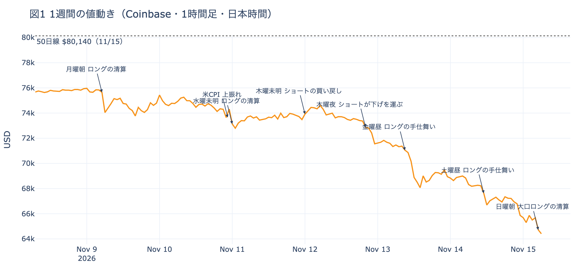
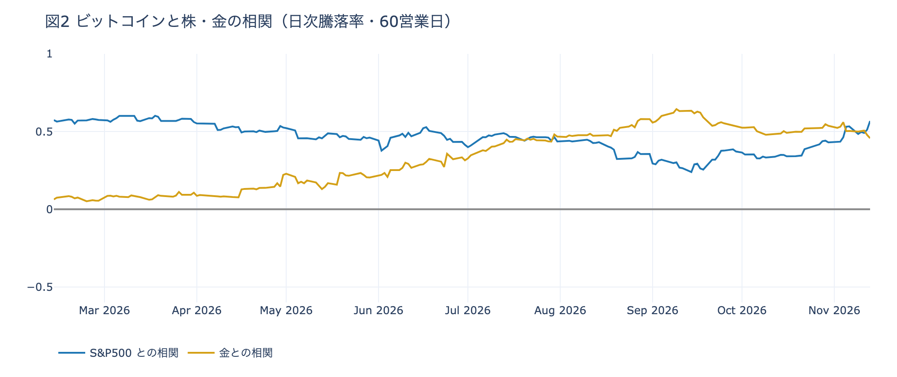

# 【11/09〜11/15】15%の下げは売りが強まったからではなく、先物の受け止め手が去ったから

**2026年11月15日**

ビットコインはこの1週間で14.8%下げ、$64,000台で日曜日の朝を迎えました。現物を売る側の勢いは、前の週よりむしろ和らいでいます。下げが大きくなったのは、先物で上げに賭けて売りを受け止めていた人たちが、週の後半に受け止めるのをやめたからでした。この号の「1週間」は、日本時間の11月8日朝7時から15日朝7時までです。毎朝出している日次の号のうち、11/09〜11/15 の7本が扱った期間にあたります。

* **起きたこと**：ETFは5営業日すべて流出し、長期保有者（＝155日以上コインを動かしていない持ち主）も減らし続けた。ただ売りの数字はどれも前の週より浅いのに、1週間で14.8%下げた
* **この週は**：前半は先物で上げに賭ける人が月曜の下げのあとに買い直して売りを受け止めた。後半は利上げの織り込みでその賭けの見返りが細り、受け止め手が減った分だけ下げが速まったと見ている
* **この支えの性質**：先物の賭けは、金利の向かい風が続くと清算と見返りの縮みで少しずつ抜ける。抜けたあとに現物の買い手が代わりに入らなかったので、下げは週末まで続いた
* **確かめる数字**：資金調達率と短期金利の差、建玉、Coinbase Premium、ETFの4つで、受け止め手が戻ってきたかを確かめられる

## 1. 売る側は強まっていないのに、下げは週の後半に速まった

**図1 1週間の値動き（Coinbase・1時間足・日本時間）**

この週、現物を売る側は前の週から続く形のままでした。ETF（＝証券口座から買えるビットコインの投資信託）は米国の5営業日すべてで流出し、長期保有者も、手放すコインが平均して買値より安い価格のまま保有量を減らしています。米国の取引所 Coinbase の価格は海外の取引所より安い状態が続きました。この価格差を Coinbase Premium（＝アメリカとそれ以外の価格差）と呼び、マイナスは米国の買いが弱いことを表します。それでも、ETFから出ていった額も、Coinbase Premium の沈み方も、長期保有者の減り方も、前の週より小さくなっています（数字は末尾の表）。

それなのに、下げは週を追って速まりました。月曜から水曜までは$72,000〜$75,000台を行き来し、米CPI（＝米国の消費者物価指数）が予想を上回った火曜の夜の下げも、翌日には$74,000台へ戻しています。崩れたのは木曜の夜からで、3日続けて大きく下げ、200日線（＝過去200日の終値の平均）も割り込みました。売る側が同じ強さのままなら、変わったのは受け止める側だと見ています。

## 2. 先物の買い直しが売りを受け止め、見返りが細ると受け止め手が去った

受け止めていたのは、先物の参加者でした。仕組みは3段でつながっています。

**① 月曜の下げのあと、先物で上げに賭ける人が買い直した。** 先物は、ビットコインを受け渡さず、値上がりか値下がりかだけに賭ける取引です。手元のお金の一部を担保（＝証拠金）として預ければ、その何倍もの額で賭けられます。月曜の朝にロング（＝上げへの賭け）の清算（＝証拠金不足で強制的に閉じられた取引）で下げたあと、月曜の1日で建玉（＝まだ閉じていない賭けの総量）は約4%増えました。ロングがショート（＝下げへの賭け）より多い状態は、7つの朝すべてで続いています。ただ火曜の夜の下げのあとはロングが買い直されず、水曜の戻りを運んだのはショートの買い戻しでした。

**② 先物の買いは、値段の差を埋める業者を通じて現物の買いに変わる。** ロングが多いと、ロングはショートに金利を払います。これが資金調達率です。現物を買い、同じ量の先物でショートを持てば、値動きの損得を消したままこの金利を受け取れます。これをする業者を裁定業者と呼びます。比べる相手は短期金利（＝ドルを米国の短期国債で持つだけで受け取れる金利）で、火曜と水曜の朝には資金調達率がそれを5ポイントあまり上回っていました。業者が現物を買う理由が大きかったぶん、ETFや長期保有者の売りは引き取られたと見ています。誰が現物を買ったかを示すデータは無く、ここは見立てです。

**③ 利上げの織り込みで、賭けの見返りが細った。** 米CPIの上振れのあと、12月のFOMC（＝米国の金利を決める会合）での利上げが確実視され、米10年債利回りも上がり続けました。その間に、資金調達率が短期金利を上回る分は火曜の朝から5つの朝続けて縮み、日曜の朝には1.10ポイントでした。木曜と土曜の夜には新しいショートが積まれ、金曜と土曜の昼、日曜の明け方にはロングが降りて、大口のロングの清算が下げを加速させています。

①と③は数字で確かめたことです。建玉は1週間で見ると週の初めとほとんど変わっていません。ロングが一斉に逃げたのではなく、買い直す人が来なくなり、その場所をショートが埋めた週でした。

## 3. 先物の支えは向かい風で少しずつ抜け、代わりの買い手はいなかった

先物のロングは、値上がりを待って現物を持つ人とは違います。金利の向かい風の中では、下げるたびに一部が清算で振り落とされ、見返りが細れば裁定業者が現物を持つ理由も薄れます。支えは一度に崩れず、日ごとに痩せます。後半に下げが速まったのは、その痩せ方が積み重なった結果です。

代わりに入る買い手は、この週にはいませんでした。8〜9月の戻りを支えたETFは、9月に約26.5億ドルが入りましたが、11月は13日までで約23.5億ドルの流出です。現物を持ち続ける買い手が引いたまま、すぐ降りる先物の賭けだけが値段を支えていたぶん、細い支えでした。

反例もあります。米国株が下げのきっかけになったのは、NVIDIAが売られた火曜の深夜の1回だけです。木曜の夜はNVIDIAの急落より3時間以上前から下げ、金曜の夜の米国の生産者物価指数でもほとんど動かず、土曜の下げは証券市場が閉まっている間に起きました。外部環境の出来事が押したのではなく、金利の高さを抱えたまま、先物の持ち高を通って下げた週です。

### 一歩引くと：株が上げた週に、ビットコインは金と同じ側で売られた

**図2 ビットコインと株・金の相関（日次騰落率・60営業日）**

相関（＝2つの値動きがどれだけ同じ向きにそろうか。1に近いほどそろう）で見ると、いまのビットコインは株とよく連れて動いています。60営業日の株との相関は0.57で、この1年の幅の上の端にあります。

それでも、この週は株と逆でした。米国の5営業日で、米国の代表的な株価指数 S&P500 は+2.5%、ビットコインは−9.9%、金は−4.6%です。米CPIの日も、ビットコインと金がそろって約2%下げ、S&P500 は−0.38%にとどまりました。VIX（＝株式市場の恐怖指数）は週で25%下がり、株が崩れる日は一度もありません。

一方、直近1年にVIXが1日で10%以上跳ねた27回では、ビットコインの値動きの中央値は−2.47%と、S&P500 の2倍近く下げています。株が崩れる日には株より大きく下げ、株が上げる週には乗らない。この週に効いたのは株の気分ではなく金利で、ビットコインは利息を生まない金と同じ側で売られたと見ています。理由までは確かめていないので、ここは見立てです。

## 4. 受け止め手が戻ったかは、4つの数字で確かめられる

| 数字 | いまの値 | 何がわかるか |
|---|---|---|
| 資金調達率と短期金利の差 | +1.10pt | 広がれば、裁定業者が現物を持つ理由が戻る。この週は火曜の+5.43ptから5つの朝続けて縮んだ |
| 建玉（1週間の変化） | +0.6% | 価格が下げても減っていない。ロングが積み直されているか、ショートが積まれているかは資金調達率と合わせて見る |
| Coinbase Premium（1週間平均） | −0.115%（前の週 −0.149%） | プラスに戻れば、現物を持ちたい米国の買い手が帰ってきたしるし |
| ETF（5営業日） | −10.7億ドル（5日とも流出） | 流入に戻れば、先物に代わる支えが入ったしるし |

オプションは、決めた期日に決めた価格でビットコインを売り買いできる権利です。その期日を満期、売る権利をプット、買う権利をコールと呼びます。土曜の下げのあと、11月18日までの満期のIV（＝値動きの幅の予想）は60台と、前日の20〜30台から2倍前後に跳ねました。全体のIVは実現ボラティリティ（＝過去の値動きの幅）をわずかに上回るだけで、目の前の数日の権利料にだけ、先の満期に対する上乗せが乗っています。

| 日付 | イベント | 何に効くか |
|---|---|---|
| 11/18（水）7:00ごろ | NVIDIAの決算（米国時間17日の引け後）。最高経営責任者の辞任後、初めての決算 | 米国株（ナスダック100） |
| 11/19（木）4:00 | FOMCの議事要旨（10月27〜28日分） | 金利 |
| 11/20（金）17:00 | オプションの満期。IVは57と、12月25日の満期より高い | 目の前の値動きへの備えの期限 |
| 11/25（水） | 米10月のPCE物価指数 | 金利 |
| 11/30（月）米国時間の引け | MSCIの指数から米Strategy（＝ビットコインを大量に持つ米企業）が外れる実施日 | Strategyの株と、指数に連動する資金 |
| 12/4（金）22:30 | 米11月の雇用統計 | 金利 |
| 12/9（水） | FOMC。0.25ptの利上げは確実視され、0.5ptの利上げも約4割5分まで織り込まれている | 金利。結果は日本時間10日早朝 |
| 12/25（金）17:00 | オプションの最も大きな満期（約14.4万BTC、全満期の40%） | 約$74,300以上のコールの期限 |

## 数字の置き場

### 7つの号が書いたこと

| 号 | 朝7時5分の価格 | 前の朝からの動き |
|---|---|---|
| 11/09（月） | 約$74,591 | 静かな日曜の最後の1時間に、ロングの手仕舞いと清算で一段安。はっきりしたきっかけは無い |
| 11/10（火） | 約$74,912 | 米国とイランの協議への期待で原油安・株高。ビットコインの戻りは株の3分の1に届かず、1日でロングが積み増された |
| 11/11（水） | 約$73,804 | 米CPIの上振れの22時台と、NVIDIAが売られた0時台の2段で下げ。ロングの清算が下げを加速させた |
| 11/12（木） | 約$74,334 | きっかけは無く、米CPIの夜に積まれたショートの買い戻しで小さく戻した |
| 11/13（金） | 約$71,426 | 20時台から新しいショートが積まれて下げ、23時台に大口のロングの清算で加速。200日線を割った |
| 11/14（土） | 約$68,286 | 金曜の昼にロングの手仕舞いで$68,000台へ。夜の米国の生産者物価指数では動かなかった |
| 11/15（日） | 約$64,207 | 証券市場が閉まった土曜に昼・夜・明け方の3段で下げ。明け方は大口のロングの清算が加速させた |

1週間の値幅は19.1%で、高値は8日22時台の$76,095、安値は15日6時台の$63,891です。50日線（＝過去50日の終値の平均）は$80,140で、価格はその19.9%下にいます。

### 参加者ごとの数字

| 参加者 | この週の動き | 根拠 |
|---|---|---|
| 長期保有者 | 利益の出ない価格で減らし続けたが、減り方は前の週より小さい | 保有量の30日変化（1週間平均）が約−22.5万BTC → 約−18.2万BTC。7つの号すべてで、手放したコインは平均して買値より安かった |
| 米国の現物の買い手 | 売りの側にとどまったが、売りは浅くなった | Coinbase Premium の1週間平均は7つの朝すべてでマイナス、−0.149% → −0.115%。ETFは5営業日すべて流出、差し引き −10.7億ドル（前の週は −12.8億ドル） |
| 先物の参加者 | 前半はロングを積み直し、後半はロングが降りてショートが積まれた | 資金調達率は7つの朝すべてでプラス。短期金利との差は +1.78pt → +5.43pt（火曜）→ +1.10pt。建玉は96,130BTC → 101,263BTC（金曜）→ 96,713BTC |
| オプションの参加者 | 下げへの備えを外さず、年末の上げへの賭けも残した | 7つの号すべてで、全部の満期でプットの権利料がコールより高かった。12月25日の満期ではコールがプットの1.4〜1.5倍のまま。11月18日までの満期のIVは土曜の朝の20〜30台から日曜の朝に60台へ |

- ETFの数字は米国の11/09〜11/13 の5営業日です（11/09 −2.0億ドル、11/10 −1.0億ドル、11/11 −3.0億ドル、11/12 −2.8億ドル、11/13 −1.9億ドル）

### 株・金との相関

| 相関を測った期間 | S&P500 | 金 |
|---|---:|---:|
| 30営業日（10/05〜） | +0.65 | +0.39 |
| 90営業日（7/10〜） | +0.45 | +0.49 |
| 180営業日（3/02〜） | +0.45 | +0.39 |
| 1年（2025/11/17〜） | +0.47 | +0.23 |

---

<small>（数値は11月15日7時5分（日本時間）までのデータに基づきます。価格は Coinbase の1時間足で、1週間は11月8日7時から15日7時までです。相関と騰落率は、ビットコインの日足（UTC 0時締め＝米東部20時）と、株・金・VIX が米国で取引された日の終値を、同じ米国の日付どうしで合わせて計算しました。週の騰落率の比較は米国の11月6日から13日までです。長期保有者の保有量は11月13日時点で、ETFや取引所が預かっている分も含まれます。ETF資金フローは11月13日分までです。FOMCの見込みは11月13日のFF金利先物の終値から計算したものです。オプションは Deribit の全銘柄です。）</small>

*本稿は情報提供を目的としたものであり、投資助言ではありません。将来の価格動向を保証・示唆するものではなく、投資判断は各自の責任において行ってください。*
