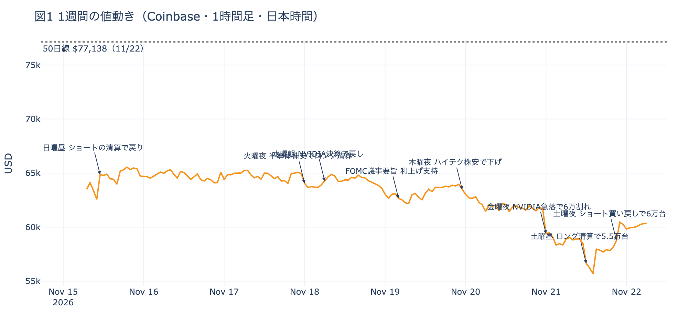
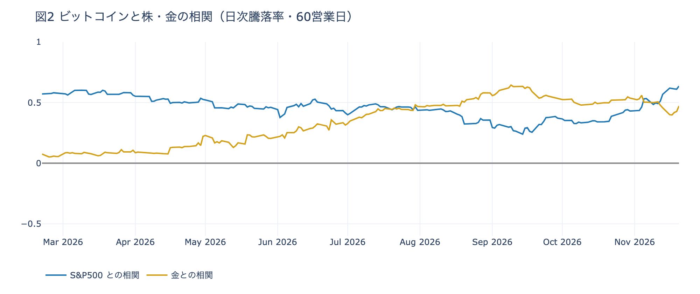

# 【11/16〜11/22】ハイテク株の崩れが現物の売りまで届き、戻りは買い戻しだけだった

**2026年11月22日**

ビットコインはこの1週間で6.3%下げ、$60,000台で日曜日の朝を迎えました。米国のハイテク株が崩れた夜に下げが進み、週の後半にはETFの買い手と長期保有者の売りも強まっています。戻りは何度もありましたが、どれも下げに賭けていた人の買い戻しで、新しい買い手が運んだ戻りはありません。この号の「1週間」は、日本時間の11月15日朝7時から22日朝7時までです。毎朝出している日次の号のうち、11/16〜11/22 の7本が扱った期間にあたります。

* **起きたこと**：NVIDIA を中心に米国のハイテク株が崩れた夜に、ビットコインも下げた。週の後半はETFからの流出が膨らみ、長期保有者（＝155日以上コインを動かしていない持ち主）も減り方を大きくした
* **この週は**：株の崩れは先物の清算を通って価格になり、週の後半には現物を持つ側の売りにも届いたと見ている。先物の買いを現物へ渡す業者の誘因は、7つの朝のうち5つで無かった
* **この戻りの性質**：7つの号が書いた戻りは、どれも下げに賭けた人の買い戻しだった。賭けを閉じ終えれば止まる買いで、新しい買い手が入った戻りは一度も無い
* **確かめる数字**：資金調達率と短期金利の差、建玉、ETF、Coinbase Premium、長期保有者の保有量の5つで、売りが現物の側に残っているかを確かめられる

## 1. 下げは株が崩れた夜に進み、週の後半は現物を持つ側も売った

**図1 1週間の値動き（Coinbase・1時間足・日本時間）**

週の前半は$62,000〜$66,000の間を行き来しました。日曜の昼前に$62,000の手前まで下げて戻し、月曜は前の朝とほぼ同じ水準で終えています。下げが進んだのは火曜の夜からで、金曜まで4晩続けて、米国の株式市場が開いている時間に段を踏んで下げ、金曜の夜に$60,000を割りました。証券市場が閉まった土曜は、昼過ぎに週の安値$55,106まで下げ、夜には$60,000台へ戻る往復です。

現物を持つ側の売りは、週の後半に強まりました。ETF（＝証券口座から買えるビットコインの投資信託）は米国の5営業日のうち4日が流出で、差し引きの流出は約12.5億ドルと前の週より膨らんでいます。長期保有者が持つ量も、30日で約22.1万BTC減りました（1週間平均）。前の週より減り方が大きく、手放したコインは平均して買値より安い、損失の出る価格での減り方です。

反例は Coinbase Premium（＝アメリカとそれ以外の価格差）です。マイナスは、米国の取引所 Coinbase で買いが弱いことを表します。1週間平均は7つの朝すべてでマイナスでしたが、前の週より深かったのは20日の朝だけです。金曜と土曜の朝の号が「過去300日でいちばん深い」と書いた値は集計途中のもので、確定した値はそこまで沈んでいません。米国の売りが強まったのはETFの側で、取引所の米国の買い手は前の週と同じ弱さのままです。

## 2. 株の崩れは先物を通って価格になり、後半は現物の売りに届いた

この週の下げは、4段でつながっています。

**① 口火は、米国のハイテク株が崩れた夜だった。** NVIDIA の決算を控えた火曜、Anthropic が上場した木曜、NVIDIA が1日で14%下げた金曜の3つの夜、ビットコインの大きな下げは米国株が売られた時間と重なっています。株がいつも口火だったわけではありません。月曜の夜は半導体株が売られた時間にビットコインは上げ、水曜の夜は株が上げるなかで、FOMC（＝米国の金利を決める会合）の議事要旨などの利上げの材料を受けて下げました。週の安値を付けた土曜の昼の下げも、証券市場が閉まっていて株の口火はありません。12月の0.5ptの利上げの織り込みはその後に約1割まで下がっていて、後半の下げの口火は金利ではありません。

**② 先物では、下げにショートが積まれ、安値を拾ったロングが振り落とされた。** 先物は、ビットコインを受け渡さず、値上がりか値下がりかだけに賭ける取引です。手元のお金を担保（＝証拠金）にして、その何倍もの額で賭けられます。上げへの賭けをロング、下げへの賭けをショートと呼びます。水曜と木曜の夜は、下げの途中でショートが積まれる一方、安値を拾いに入ったロングが清算（＝証拠金不足で強制的に閉じられた取引）され、その清算が下げを速めました。2晩続けて振り落とされたロングは、金曜の夜には入ってきていません。

**③ 先物の買いを現物へ渡す業者には、動く理由がほとんど無かった。** ロングが多いと、ロングはショートに金利を払います。これが資金調達率です。現物を買い、同じ量の先物でショートを持つ裁定業者は、この金利を受け取るために現物を持ちます。比べる相手は短期金利（＝ドルを米国の短期国債で持つだけで受け取れる金利）で、この週は7つの朝のうち5つで資金調達率がそれを下回りました。上回ったのは、安値拾いのロングが入った木曜と金曜の朝だけです。先物の買いが現物の買いに変わる道は、週の大半で閉じていました。

**④ 週の後半、売りは現物を持つ側に届いた。** ETFからの流出は米国の19日に1日で約5.8億ドルへ膨らみ、長期保有者の減り方も金曜の朝の号から3日続けて前の週を上回りました。30日以上置いたコインが値下がりした状態で再び送金された量は、水曜の朝の号ですでに平年の3倍に達し、その後も増えました。株が崩れ、先物の持ち高が整理されたあとに、現物を長く持つ人たちの売りが強まった順番です。株を見て売ったのか、値下がりそのものに押されたのかはデータでは分けられず、ここは見立てです。

## 3. 戻りを運んだのは、下げに賭けた人の買い戻しだけだった

戻りは、日曜の昼、月曜の夜、木曜の昼、土曜の夜と何度もありました。7つの号が書いた戻りは、どれもショートの買い戻しで、価格が上がる間に建玉（＝まだ閉じていない賭けの総量）が減っています。ロングが新しく積まれて上げた戻りは、一度もありません。

ショートの買い戻しは、賭けを閉じるための買いです。閉じ終えれば止まり、値上がりを待って持ち続ける人は残りません。土曜の往復のあと、建玉は1日で4.4%減って持ち高は軽くなりましたが、残った持ち高でもショートのほうが多く、資金調達率は1日をならしてマイナスです。買い戻しで戻した値段を、持ち続ける買い手が引き継いだ形跡はありません。

支えは週を追って細っています。10月半ばは先物のロングが売りを受け止め、前の週はその受け止め手が去り、この週は戻らないまま現物を持つ側の売りが加わりました。8〜9月の戻りを支えたETFは、11月は20日までで約35.9億ドルの流出です。売られたコインを誰が引き取ったかはデータに無く、20%の値幅を動かしてようやく引き取り手が見つかった週だったと見ています。

降りなかった参加者もいます。オプションは、決めた期日に決めた価格でビットコインを売り買いできる権利で、その期日を満期、買う権利をコール、売る権利をプットと呼びます。12月25日の最大の満期では、7つの号すべてでコールの持ち高がプットの1.4〜1.5倍のままで、$55,000台まで下げた土曜の昼にも減っていません。年末に向けた上げへの賭けだけは、この週も残りました。

### 一歩引くと：株が売られた夜も、金利で金が売られた日も、ビットコインは売られる側にいた

**図2 ビットコインと株・金の相関（日次騰落率・60営業日）**

相関（＝2つの値動きがどれだけ同じ向きにそろうか。1に近いほどそろう）で見ると、いまのビットコインは株とも金ともよく連れて動いています。60営業日の株との相関は0.64で、この1年の幅のいちばん上にあります。

この週は、株も金も売られました。米国の13日から20日までで、米国の代表的な株価指数 S&P500 は−8.6%、金は−9.5%で、ビットコインはそのどちらより大きい−13.8%です。売られ方の違う日を分けても、ビットコインはどちらの日も売られる側にいました。FOMC の議事要旨が出た米国の18日は、S&P500 がほとんど動かないなかで、ビットコインは金と同じく3%近く下げています。

株が崩れる日の動きは、型どおりではありませんでした。直近1年に VIX（＝株式市場の恐怖指数）が1日で10%以上跳ねた28回では、ビットコインの値動きの中央値は−2.26%で、S&P500 の−1.40%より大きく下げています。この週はそのうち4回が入っていて、株より大きく下げたのは金曜と週末を含む月曜の2回、株より小さく済んだのは火曜と木曜の2回でした（数字は末尾の表）。

この週のビットコインは、株の仲間とも金の仲間とも決まらず、何かが売られる局面でいっしょに売られる側にいたと見ています。先物で張った持ち高が多いぶん、どちらの売りでも清算を通って下げが速まるのが理由の一つだと考えていますが、ここは見立てです。

## 4. 売りが現物の側に残っているかは、5つの数字で確かめられる

| 数字 | いまの値 | 何がわかるか |
|---|---|---|
| 資金調達率と短期金利の差 | −5.30pt（直近34日でいちばん低い） | プラスで大きいほど、裁定業者が現物を持つ理由がある。この週は7つの朝のうち5つでマイナスだった |
| 建玉（1週間の変化） | −5.0% | 上げる日に増えていれば、ロングが戻ってきたしるし。減っていれば、戻りはまだショートの買い戻し |
| ETF（5営業日） | −12.5億ドル（流出4日・流入1日） | 流入に戻れば、現物を持ち続ける買い手が戻ってきたしるし |
| Coinbase Premium（1週間平均） | −0.104%（前の週 −0.116%） | プラスに戻れば、取引所で現物を買う米国の買い手が帰ってきたしるし |
| 長期保有者の保有量の30日変化（1週間平均） | 約−22.1万BTC（前の週 約−18.2万BTC） | 減り方が小さくなれば、現物を長く持つ人の売りが和らいだしるし |

オプションの権利料（＝オプションを買う人が払う金額）にも、警戒が出ています。IV（＝値動きの幅の予想）は全体で52.5と過去1年の下から98%の高さで、実現ボラティリティ（＝過去の値動きの幅）を7.1pt上回りました。どの満期もプットの権利料がコールより高く、その度合いがいちばん大きいのは、感謝祭をまたぐ11月27日の満期です。米PCE物価指数と感謝祭の休場が重なる週に、下げへの備えがいちばん厚く値付けされています。

| 日付 | イベント | 何に効くか |
|---|---|---|
| 11/25（水）22:30 | 米10月のPCE物価指数（＝米国の物価統計）と、7〜9月期のGDPの改定値 | 金利 |
| 11/26（木） | 米国は感謝祭で株式市場が休場 | 米国株・ETFの取引が止まる |
| 11/27（金）17:00 | オプションの満期。プットの権利料がコールより高い度合いが、全満期でいちばん大きい | 下げへの備えの期限 |
| 11/30（月）米国時間の引け | MSCIの指数から米Strategy（＝ビットコインを大量に持つ米企業）が外れる実施日 | Strategyの株と、指数に連動する資金 |
| 12/3（木） | ドイツ・ライプツィヒ地裁で Movie2k 事件の裁判が再開。被告が4万BTCを引き渡せば打ち切るという裁判所の案に、双方はまだ答えていない | 当局の手に渡りうる4万BTC |
| 12/4（金）22:30 | 米11月の雇用統計 | 金利 |
| 12/9（水） | FOMC。0.25ptの利上げは織り込み済みで、0.5ptの利上げの織り込みは約1割（週の初めは約5割弱） | 金利。結果は日本時間10日早朝 |
| 12/25（金）17:00 | オプションの最も大きな満期（約15.7万BTC、全満期の38%） | 約$69,400以上のコールの期限 |

## 数字の置き場

### 7つの号が書いたこと

| 号 | 朝7時5分の価格 | 前の朝からの動き |
|---|---|---|
| 11/16（月） | 約$65,027 | 日曜の昼前に$62,000の手前まで下げ、ショートの買い戻しで2回戻した。清算が戻りを加速させた。はっきりしたきっかけは無い |
| 11/17（火） | 約$65,374 | 日中に積まれたショートが、米国株の取引開始の時間に買い戻された。半導体株が売られた時間に、ビットコインは逆に上げた |
| 11/18（水） | 約$64,161 | NVIDIA の決算を前に AI・半導体株が売られた0時台に下げ、ロングの清算が加速させた。決算が出た朝6時台に戻した |
| 11/19（木） | 約$62,340 | Waller 理事の0.5ptの利上げ論と FOMC の議事要旨の夜に、段を踏んで下げた。株が上げた時間にも下げ、ショートが積まれた |
| 11/20（金） | 約$61,742 | 昼までの戻りを、Anthropic の上場の日にハイテク株が崩れた夜に失った。安値拾いのロングが清算された |
| 11/21（土） | 約$58,979 | NVIDIA −14%、ナスダック100 −5.6% の夜に$60,000を割った。安値拾いのロングは入らなかった |
| 11/22（日） | 約$60,194 | 証券市場が閉まった土曜に、ロングの清算で$55,000台へ、ショートの買い戻しで$60,000台へ往復した |

1週間の値幅は20.0%で、高値は15日18時台の$66,100、安値は21日15時台の$55,106です。50日線（＝過去50日の終値の平均）は$77,138で、価格はその22.0%下にいます。

### 参加者ごとの数字

| 参加者 | この週の動き | 根拠 |
|---|---|---|
| 長期保有者 | 損失の出る価格で減らし続け、週の後半に減り方が前の週を上回った | 保有量の30日変化（1週間平均）が約−18.2万BTC → 約−22.1万BTC。長期保有者SOPR（＝長期保有者が動かしたコインの売値÷買値）の1週間平均は0.96 → 0.81で、7つの号すべてで1を下回った |
| 米国の現物の買い手 | ETFからの流出は膨らんだが、Coinbase Premium は深まっていない | ETFは5営業日で流入1日・流出4日、差し引き −12.5億ドル（前の週は −10.7億ドル）。Coinbase Premium の1週間平均は7つの朝すべてでマイナス、−0.116% → −0.104% |
| 先物の参加者 | 下げでショートを積み、安値拾いのロングは2晩清算されて退いた。戻りはどれもショートの買い戻し | 資金調達率と短期金利の差は、7つの朝のうち5つでマイナス、+1.10pt（前の週の終わり）→ −5.30pt。建玉は96,713BTC → 92,566BTC（水）→ 97,257BTC（金）→ 91,854BTC |
| オプションの参加者 | 下げへの備えを厚くし、年末の上げへの賭けも残した | 7つの号すべてで、全部の満期でプットの権利料がコールより高かった。IVは全体で47.3 → 43.1（水）→ 52.5。12月25日の満期ではコールがプットの1.4〜1.5倍のまま |
| 30日以上コインを置いていた持ち主 | 値下がりした状態での再送金が増えたが、過去の大きな下げの底の量には届いていない | 1週間平均で約2.2万BTC/日 → 約3.4万BTC/日（11月20日時点）。2017年以降の中央値は約0.9万BTC/日、過去の大きな下げの底は約4.1万〜8.4万BTC/日 |

| ETF（米国の営業日） | 億ドル |
|---|---:|
| 11/16（月） | +0.1 |
| 11/17（火） | −2.4 |
| 11/18（水） | −3.1 |
| 11/19（木） | −5.8 |
| 11/20（金）※ | −1.2 |
| 5営業日の合計 | −12.5 |

※ iShares（IBIT）の数字がまだ入っていない合計

| Coinbase Premium（確定した日ごとの値） | 値 |
|---|---:|
| 11/19 | −0.12% |
| 11/20 | −0.23% |
| 1週間平均（11/21 まで） | −0.104% |

| VIX が1日で10%以上跳ねた日 | ビットコイン | S&P500 | 金 |
|---|---:|---:|---:|
| 直近1年の28回の中央値 | −2.26% | −1.40% | −1.06% |
| 11/16（月）※週末の分を含む | −5.01% | −1.92% | −0.86% |
| 11/17（火） | +0.09% | −1.03% | +0.29% |
| 11/19（木） | −1.70% | −2.02% | −1.51% |
| 11/20（金） | −5.00% | −3.70% | −4.62% |
| （参考）FOMC の議事要旨の日 11/18（水） | −2.92% | −0.23% | −3.16% |

### 株・金との相関

| 相関を測った期間 | S&P500 | 金 |
|---|---:|---:|
| 30営業日（10/12〜） | +0.68 | +0.49 |
| 90営業日（7/17〜） | +0.51 | +0.51 |
| 180営業日（3/09〜） | +0.48 | +0.43 |
| 1年（2025/11/24〜） | +0.48 | +0.26 |

---

<small>（数値は11月22日7時5分（日本時間）までのデータに基づきます。価格は Coinbase の1時間足で、1週間は11月15日7時から22日7時までです。相関と騰落率は、ビットコインの日足（UTC 0時締め＝米東部19時）と、株・金・VIX が米国で取引された日の終値を、同じ米国の日付どうしで合わせて計算しました。週の騰落率の比較は米国の11月13日から20日までです。長期保有者の保有量は11月20日時点で、ETFや取引所が預かっている分も含まれます。ETF資金フローは11月20日分までで、11月20日分は iShares（IBIT）の数字がまだ入っていない合計です。FOMCの見込みは11月20日のFF金利先物の終値から計算したものです。オプションは Deribit の全銘柄です。）</small>

*本稿は情報提供を目的としたものであり、投資助言ではありません。将来の価格動向を保証・示唆するものではなく、投資判断は各自の責任において行ってください。*
